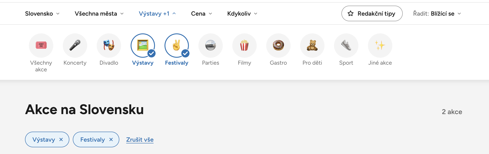
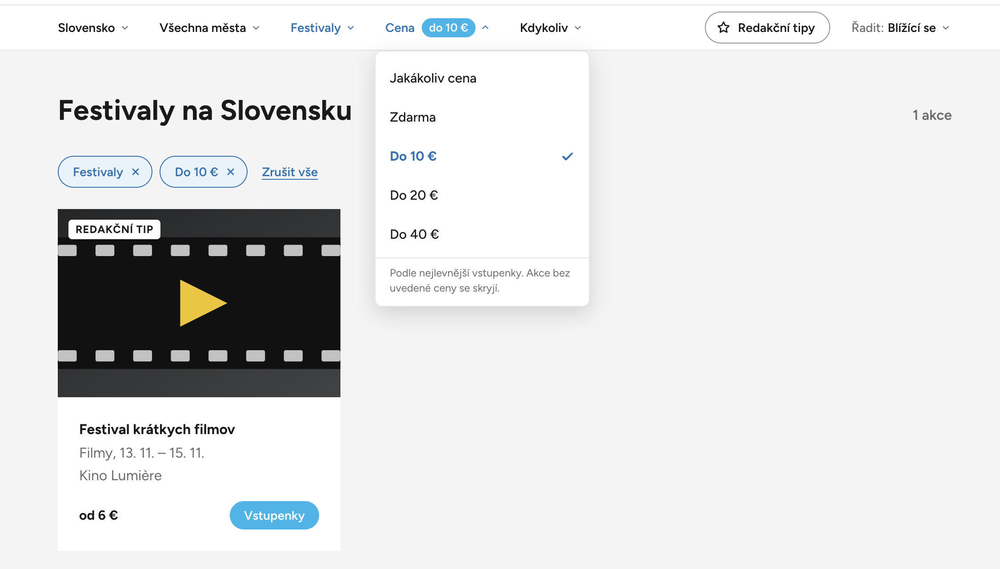
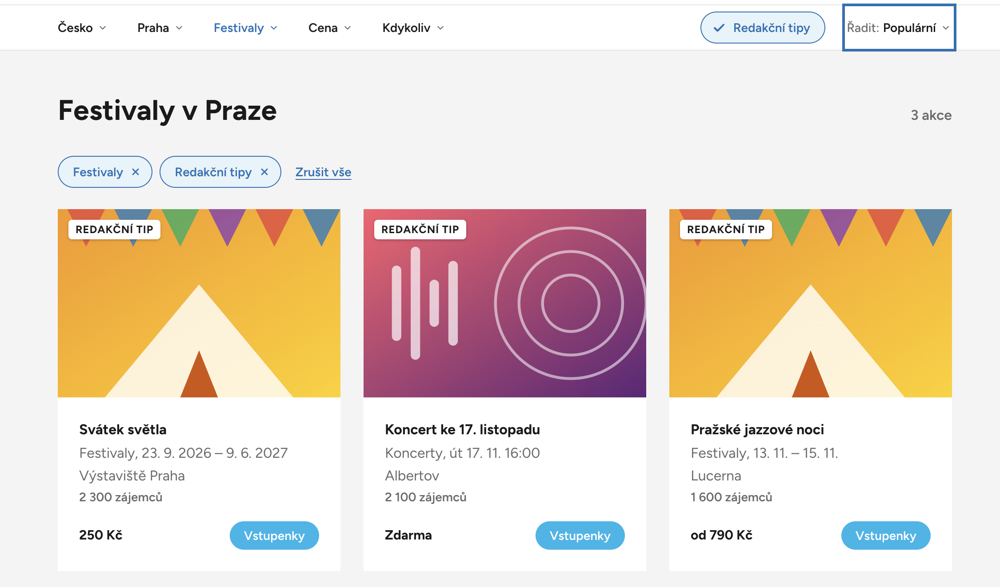
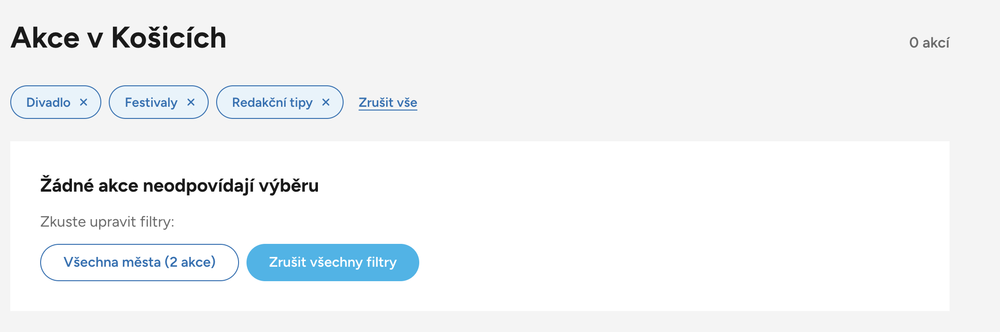

# GoOut event discovery: a product concept

A clickable prototype of how GoOut's event listing could answer one question faster: **"What can I go to this weekend, that I'd enjoy, and that I can afford?"**

[](https://github.com/t-raidlova/goout-filters-ux-concept/actions/workflows/ci.yml)

**Live demo:** https://t-raidlova.github.io/goout-filters-ux-concept/
**Case study:** [case-study.md](case-study.md): the problem, discovery, design decisions and what I'd validate next.
**Quality:** [test strategy](docs/test-strategy.md) · [bug reports](docs/bug-reports.md) · [accessibility audit](docs/accessibility-audit.md)

> **Independent concept, not an official GoOut project.** See the [disclaimer](#disclaimer).

## The problem

On GoOut's desktop listing ([discovery.md](docs/discovery.md)):

- Category is a single choice, so "concerts or parties" takes two searches.
- Cards don't show a price, and there's no price filter or "free" label.
- One "Redakční tipy ▾" dropdown both reorders and hides events, so users can't tell which is happening.

These are hypotheses, not validated findings: no GoOut user data was available.

## Filter UX improvements

The prototype extends GoOut's existing filter bar instead of inventing a new one:

```
Česko ▾   Praha ▾   Všechny kategorie ▾   Cena ▾   Kdykoliv ▾        Redakční tipy   Řadit: Blížící se ▾
```

1. **Several categories at once.** Tick any of GoOut's 10 categories; they combine as OR, e.g. concerts _or_ parties.
2. **A price filter.** Zdarma, do 200 Kč, do 500 Kč, do 1 000 Kč (in € for Slovensko).
3. **The price on every card.** "od 290 Kč", "Zdarma" or "Cena neuvedena".
4. **Picks and sort split apart.** "Redakční tipy" becomes a filter toggle; sort order gets its own "Řadit" control.
5. **Clear feedback.** A result count, removable filter chips, "Zrušit vše", and an empty state that suggests which filter to drop and how many events that brings back.
6. **Shareable links.** Filters live in the URL (`?cat=concerts,parties&price=200&date=weekend`).









## Key decisions

Full log in [decisions.md](docs/decisions.md).

- **Show price before filtering by it.** You can't sensibly filter by a value you can't see.
- **Price caps are "up to" and match the cheapest ticket.** The card shows that same number, so every result is explainable.
- **Unknown prices are hidden** under a price filter, and the UI says how many.
- **Categories are OR, filters are AND.** "Concerts or parties, this weekend, under 200 Kč."
- **Location and sort are context, not filters.** "Zrušit vše" keeps them.
- **Results update instantly**, without moving focus.

## Getting started

Requires **Node.js 24** ([`.nvmrc`](.nvmrc)).

```bash
nvm use
npm install
npm run dev        # http://localhost:5173
npm test           # unit and data integrity tests
npm run test:e2e   # end-to-end tests (first run: npx playwright install chromium webkit)
npm run lint
npm run build
```

Every pull request and push to `main` runs lint, unit tests, the build and the end-to-end tests. A push to `main` then deploys to GitHub Pages. The demo uses a fixed date (Friday 6 November 2026, 17:00 Prague time) and 49 fictional events.

**Stack:** React 19, TypeScript, Vite, Vitest, Playwright, axe-core, oxlint, CSS Modules. No backend and no runtime dependencies beyond React.

## Quality

| Level | What | How many |
|---|---|---|
| Unit (Vitest) | Filtering rules, prices, dates in Prague time, URL parsing, Czech labels | 80 tests |
| Data integrity (Vitest) | The mock catalogue: valid dates, prices, ids, images | 5 tests |
| End-to-end (Playwright) | User flows, shared links, keyboard, axe in 8 states, reflow at 320–1600 px | 42 tests, 80 runs in Chromium, WebKit and on an iPhone viewport |
| Manual | Screen readers, real devices, exploratory sessions | [Checklist](docs/test-strategy.md#manual-testing) |

The [test strategy](docs/test-strategy.md) explains the risks, why each case sits at its level, and which spec requirement each test covers.

**Found by the tests:** in Safari and on iPhone, choosing a price, date, sort or country applies it but leaves the dropdown open ([BUG-001](docs/bug-reports.md#bug-001)). Chrome sends the label's click on to the radio with `event.detail = 1`, and WebKit with `0`. The code read 0 as a keyboard selection. The test is marked as an expected failure in WebKit until the fix lands.

## How this was built

Built with Claude Code. I set the direction and the rules; Claude Code wrote most of the code and the first drafts of the docs.

**My part:** discovery on goout.net, the problem and priorities, and the product rules in the [spec](docs/product-spec.md) and [CLAUDE.md](CLAUDE.md): how filters combine, how prices match, what "Zrušit vše" keeps. I reviewed every change, tested it by hand and with the keyboard, and decided what stayed.

**Generated by Claude Code:** the React components, the filtering logic and its unit tests, the mock events, the deploy workflow and first drafts of the docs. Later also the Playwright suite, the data integrity tests, the CI pipeline and first drafts of the test strategy and bug reports.

**Testing decisions I made**

- **Removed redundant unit tests** (118 → 80). Tests that pinned counts from the mock data broke whenever an event was added, and others repeated an assertion already made on the same code path elsewhere.
- **Known accessibility issues are explicit, not switched off.** The axe check accepts only the known contrast pair (audit #1) and fails on anything else, instead of turning the contrast rule off.
- **Browsers:** Chromium, WebKit and an iPhone viewport. On iPhone, practically every browser runs on WebKit, so Chromium alone says nothing about iPhone users. The WebKit run found BUG-001 on its first pass.
- **Bugs are reported, not quietly fixed by the tests.** BUG-001 and BUG-002 are logged with steps and cause, and the failing check is marked `test.fail` instead of being loosened or deleted.

**What I changed or rejected**

- **"Zrušit vše":** Claude suggested resetting everything except the country, including the city. I kept the city and the sort. Clearing filters shouldn't move you to another place or change the order: location and sort are context, not filters.
- **Price range slider:** Claude suggested a slider for the price filter. I replaced it with a dropdown with a few caps (Zdarma, Do 200 / 500 / 1 000 Kč). It's faster to scan and easier with a keyboard, it matches how people think about a budget, and it fits GoOut's filter bar.
- **Sold-out events:** Claude suggested hiding sold-out and sale-ended events. I kept them, listed after the on-sale events of the same day. It's honest about what's on, and GoOut does the same.
- **Switching country:** Claude suggested converting the price filter between Kč and € when switching between Česko and Slovensko. I reset the price filter instead: a converted 200 Kč cap would be an odd amount in €.

**What I'd keep doing**

- Write the rules down (CLAUDE.md, the spec) and keep the logic pure and tested, so the agent can't silently break a product rule.
- Check AI output against the code. Text that reads well can still be wrong.

## Limitations and next steps

Front-end only: fictional events, no API, login, event detail or checkout, no mobile reference.

- **Validate:** what share of real events have a known price; test the hypotheses with analytics, interviews and A/B tests.

## Disclaimer

An **independent product concept** made for a job application. **Not an official GoOut project**, and not affiliated with or endorsed by GoOut or PLG Group. All events, prices and popularity numbers are fictional. No GoOut logo, photos or other assets are included.
