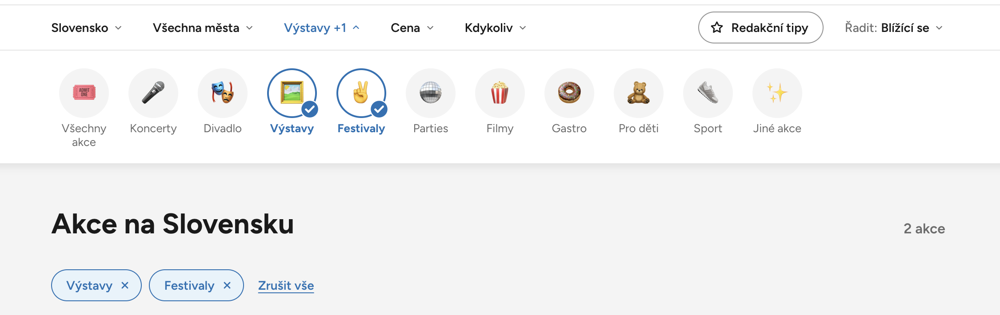
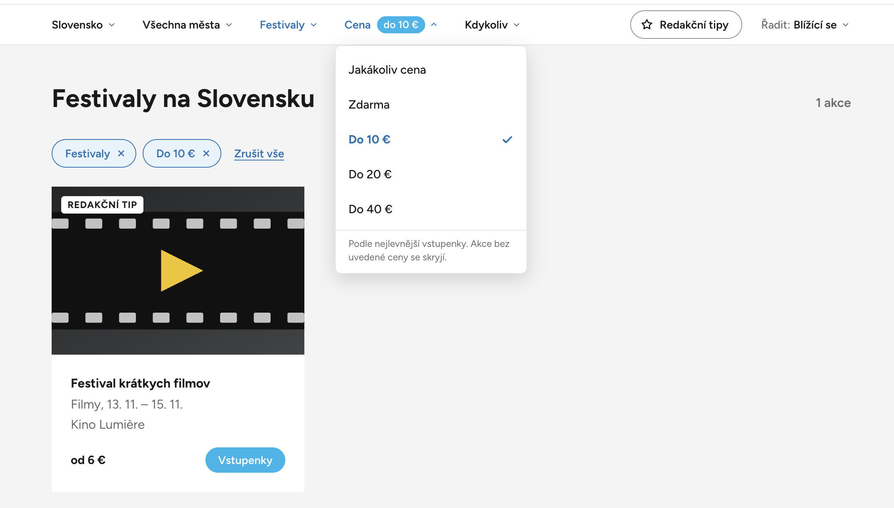
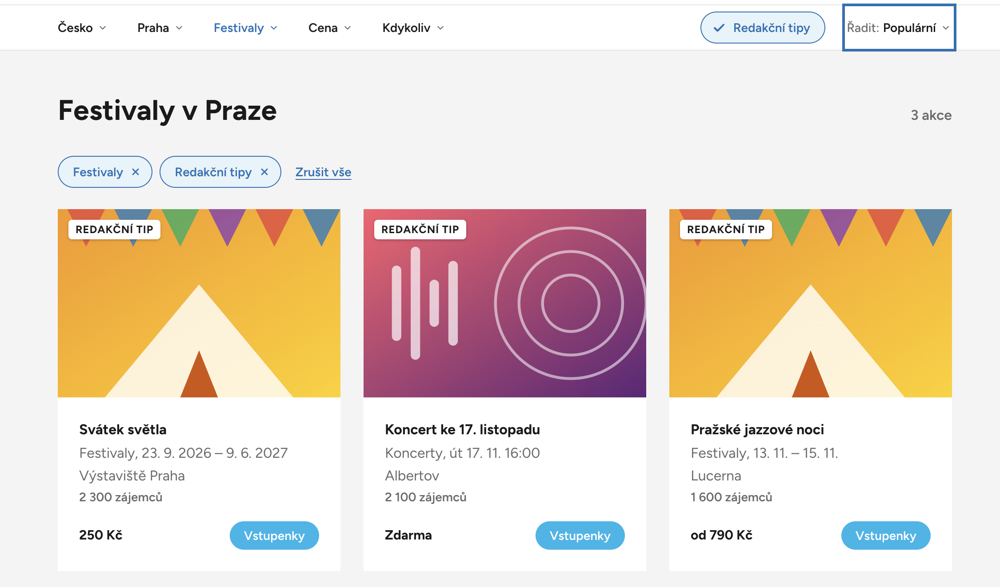

# GoOut: Rethinking Event Filtering

**UX case study · Product Builder application**
Author: Tereza Raidlová · November 2026

**Live prototype:** [t-raidlova.github.io/goout-filters-ux-concept](https://t-raidlova.github.io/goout-filters-ux-concept/?city=brno&price=500&sort=popular)

---

## 1. Overview

I looked at how the listing's filter bar helps people narrow hundreds of events down to a few relevant ones. Then I built a working prototype with three focused changes:

1. **Multiple categories at once.** Users can combine categories, for example _Výstavy + Festivaly_.
2. **A price filter, plus prices on event cards.** Users can filter by budget and compare prices without opening each event.
3. **"Redakční tipy" split from sorting.** Editorial picks become their own toggle, and sorting gets its own clearly labelled control.

**Scope:** desktop event listing, filter bar and event card.
**My role:** discovery, problem definition, UX design, front-end prototype.
**Timebox:** a short self-initiated concept, built without access to GoOut's analytics or users.

---

## 2. Discovery and observations

I don't have access to GoOut's data or users, so discovery was based on a **heuristic walkthrough** of the live site. I went through a few realistic scenarios and documented each step with screenshots:

- _"I'm in Brno this weekend and want to see an exhibition or a festival."_
- _"I want to go out tonight but I don't want to spend more than about 300 Kč."_
- _"Show me what GoOut recommends, but sorted by what's coming up soonest."_

### What I observed

**Location and date work well.**
The city picker has search and suggested cities. The date dropdown offers quick presets (Dnes, Zítra, Tento víkend…) with the actual dates shown next to them. Both follow familiar patterns, so I left them alone.

**Categories are single-select.**
The category row with illustrated icons is visually strong, but only one category can be active. Someone interested in _exhibitions or festivals_ has to browse two separate listings and keep both in their head.

**Price is missing.**
Event cards show the title, category, date, venue and a "Vstupenky" button, but no price. There is also no way to filter by price. Budget is often one of the main deciding factors when choosing an event, but right now users only find the price after clicking through to the event detail.

**"Redakční tipy" mixes two concepts in one dropdown.**
The right-hand dropdown is labelled with the active option (e.g. _Redakční tipy_) and contains _Populární, Redakční tipy, Podle kamarádů, Blížící se, Novinky_. Some of these are **sort orders** (popular, upcoming, newest). Others are **subsets of content** (editor picks, friends' activity). Because only one option can be active, users can't get _editor picks sorted by date_. The label also doesn't say that this control is about ordering.

---

## 3. Problem definition

> **People deciding where to go out can't express their real constraints (several interests, a budget, a curated selection in a chosen order) in GoOut's filters. So they browse more listings and open more event pages than they need to before they find something worth buying a ticket for.**

This breaks down into three smaller problems:

| #   | Problem                                          | Consequence                                                                      |
| --- | ------------------------------------------------ | -------------------------------------------------------------------------------- |
| P1  | Categories are single-select                     | Users with broader interests have to run several separate searches               |
| P2  | No price on cards and no price filter            | Budget is discovered late, causing extra clicks and drop-offs on the detail page |
| P3  | Sorting and editorial curation share one control | Valid combinations are impossible, and the control's meaning is unclear          |

**Hypothesis:** if the filters match how people actually decide (interest + budget + trust in curation), users will reach a relevant event with fewer steps. More of those sessions should then end on an event detail page and in a purchase.

---

## 4. Prioritisation and decisions

### Key decisions and trade-offs

- **Preset price ranges instead of a slider.** _Zdarma / Do 200 Kč / Do 500 Kč / Do 1 000 Kč_ are faster to scan and click, they map well to how people think about budget, and they're easier to use with a keyboard. A slider can come later if the data shows people want finer control.
- **Filter by the cheapest ticket.** Many events have several price tiers. Using the lowest price is consistent. The dropdown says this explicitly, and it also says that events without a price are hidden when the filter is active.
- **Keep the existing visual language.** The category icons, layout and blue accent stay.
- **Editorial picks as a toggle, not a sort.** Curation is a _filter on content_, so it combines with any sort order instead of replacing it.

---

## 5. Solution

### 5.1 Multi-select categories

- Users can select any number of categories in the icon row. Selected ones get a ring and a checkmark badge.
- The filter bar summarises the selection compactly: **"Výstavy +1"**.
- _Všechny akce_ works as a reset back to all categories.

### 5.2 Price filter and price on cards

- A new **Cena** dropdown sits between categories and date, with preset ranges.
- When a price filter is active, its value appears as a highlighted pill directly in the bar (**Cena: do 500 Kč**), so the active state is visible at a glance.
- **Every event card now shows the price** next to the ticket button: _Zdarma_, _250 Kč_, or _od 1 290 Kč_ when there are several price tiers.
- When sorted by _Populární_, cards also show the number of interested people ("3 400 zájemců"), which explains what the sort is based on.

### 5.3 "Redakční tipy" split from sorting

- **Redakční tipy** becomes a standalone toggle button with a star icon, and it can be combined with every other filter.
- Sorting gets its own explicitly labelled control: **Řadit: Populární**. Each option has a short explanation:
  - _Blížící se_: from the nearest date
  - _Populární_: by number of interested people
  - _Novinky_: most recently added
- Users can now get, for example, _editor picks in Brno under 500 Kč, sorted by date_. That combination wasn't possible before.

### 5.4 Supporting details

- **Result count** ("30 akcí") gives immediate feedback on how much each filter narrows the list.
- **Empty state with suggestions.** When a combination returns nothing, it suggests which filter to drop and how many events that brings back.
- **Active filter chips** with one-click removal, plus **"Zrušit vše"** to reset everything.
- **Filters are stored in the URL** (`?city=brno&price=500&sort=popular`), so a filtered view can be shared, bookmarked, or opened from a campaign link.

---

## 6. Prototype and accessibility

The prototype is a working front-end built on mock event data and hosted on GitHub Pages. It's meant to test interactions, not visual polish.

**Try it:** [live prototype](https://t-raidlova.github.io/goout-filters-ux-concept/?city=brno&price=500&sort=popular)

### Accessibility considerations

- **Native controls first.** Categories are real checkboxes and the country, price, date and sort options are radio buttons, each group in a `<fieldset>` with a `<legend>`. The city picker is a search field with a list of buttons. Names and states are announced without custom widgets.
- **Disclosure buttons.** Each filter in the bar is a `<button>` with `aria-expanded`; _Redakční tipy_ and _Všechny akce_ are toggle buttons with `aria-pressed`.
- **Descriptive labels.** Buttons are announced with their meaning, not only their value: e.g. _"Město: Brno"_, _"Kategorie: Všechny kategorie"_. Chip remove buttons have explicit labels such as _"Odebrat filtr: Do 500 Kč"_.
- **Live feedback without moving focus.** The result count sits in a debounced `role="status"` region, so screen reader users hear one summary after they stop changing filters.
- **Not relying on colour alone.** Selected categories have a checkmark as well as the blue ring, and selected dropdown options have a check icon.
- **Clear landmarks.** Main navigation and the filter section have their own `aria-label`s.

---

## 7. Validation, metrics and next steps

### How I'd validate

1. **Quick usability test (5–6 participants).** Give each participant the same scenarios as in discovery, on the current site and on the prototype. Measure time to a relevant event, the number of listings and detail pages opened, and where people hesitate.
2. **A/B test in production**, shipping the changes one at a time (price on cards first, since it's the cheapest and probably the highest impact). This way the effect of each change can be seen separately.

### Metrics to track

| Metric                           | What it tells us                                                             | Expected direction                 |
| -------------------------------- | ---------------------------------------------------------------------------- | ---------------------------------- |
| **Search-to-event click rate**   | Do filtered listings lead people to an event detail?                         | ↑                                  |
| **Filter adoption rate**         | Are the new filters (multi-category, price, editorial toggle) actually used? | Baseline → track                   |
| **Zero-results rate**            | Do combined filters make listings too narrow?                                | Watch: must not grow significantly |
| **Event-to-purchase conversion** | Does seeing the price upfront lead to more qualified clicks and purchases?   | ↑ (or stable with fewer bounces)   |

**Guardrails:** overall ticket revenue per session, and bounce rate on the event detail page. Showing prices could reduce clicks on expensive events. That's acceptable only if purchases don't go down.

### Next steps

- **Mobile.** Move the filters into a bottom sheet with the same logic. Most event browsing likely happens on phones.
- **Smart defaults.** Remember the last-used city and price range for returning users.
- **Bring back "Podle kamarádů"** as a second toggle next to _Redakční tipy_, for logged-in users.

---

_This is an independent concept made as part of a job application. It is not affiliated with or endorsed by GoOut._
